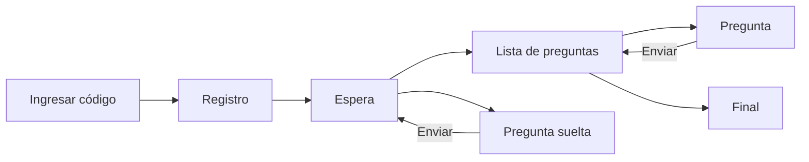

# Especificación de diseño

Referencia para modificar la interfaz de `participar.html` (celular) y `pantalla.html` (proyector). Describe tokens, componentes, estados y comportamiento tal como están en el código. Para cambiar colores, logo o tipografía sin tocar código, ver [Estética](estetica.md).

## Archivos

| Archivo | Contenido |
|---|---|
| `css/base.css` | Tokens, encabezado, botones, tarjetas, opciones, campos, mensajes, progreso y barras. Compartido por las tres páginas. |
| `temas/<preset>.css` | Valores de los tokens de cada preset. |
| `js/tema.js` | Aplica la estética de la sesión: pisa `--color-principal`, `--color-acento`, `--texto-sobre-*`, `--fuente` y `--radio`. |
| `participar.html` | Estilos propios de la vista del celular (bloque `<style>`). |
| `pantalla.html` | Estilos propios de la vista proyectada (bloque `<style>`). |

Regla: los colores se declaran solo como tokens en `css/base.css` y `temas/*.css`. Los estilos de cada página usan `var(--…)`. La única excepción es el fondo blanco fijo del QR chico, que tiene que ser blanco para que el QR se pueda leer.

## Unidades y escala

| Vista | Tamaño base (`1rem`) | Ancho de contenido |
|---|---|---|
| Celular y admin | 16 px | `main` hasta `45rem` (720 px), margen lateral `1rem` |
| Pantalla | `clamp(16px, 1.25vw, 40px)`: 16 px a 1280 de ancho, 24 px a 1920 | todo el ancho, margen lateral `2rem` |

Todas las medidas de la pantalla están en `rem`, así escalan con el ancho del proyector. En la pantalla ningún texto baja de `1rem`.

## Tokens

### Paleta

| Token | Neutro | datos-gob-ar | Uso |
|---|---|---|---|
| `--color-principal` | `#1F2937` | `#232D4F` | Fondo del encabezado y de la barra de controles. |
| `--color-acento` | `#2563EB` | `#0072BB` | Botones, opción elegida, barra de la opción líder, progreso, punto de espera. |
| `--color-secundario` | igual a `--color-acento` | `#B369ED` | Rótulos, filete bajo títulos, nombre de la actividad en el encabezado, barras no líderes. |
| `--fondo` | `#F6F7F9` | `#F6F4FC` | Fondo de página. |
| `--superficie` | `#FFFFFF` | `#FFFFFF` | Tarjetas, campos, opciones. |
| `--borde` | `#CDD2DA` | `#D5D8E3` | Borde de tarjetas y botón secundario. |
| `--borde-campo` | `#7B8391` | `#7A8099` | Borde de campos, opciones e ítems de lista. Contraste ≥ 3:1 sobre `--superficie`. |
| `--texto` | `#1A1A1A` | `#232D4F` | Texto general. |
| `--texto-suave` | `#4B5260` | `#4F5672` | Texto secundario, descripciones, totales. |
| `--exito` | `#15803D` | `#2E7D32` | Pregunta respondida, confirmación. |
| `--error` | `#B91C1C` | `#C62828` | Errores de validación y de conexión. |
| `--aviso` | `#A04A0B` | `#8A5300` | Avisos (modo de prueba, problemas al cambiar de paso). |

### Derivados

Se calculan en `css/base.css` a partir de la paleta. Un preset puede pisarlos.

| Token | Fórmula | datos-gob-ar | Uso |
|---|---|---|---|
| `--texto-sobre-principal` | blanco u oscuro según contraste (`js/tema.js`) | `#FFFFFF` | Texto sobre `--color-principal`. |
| `--texto-sobre-acento` | blanco u oscuro según contraste (`js/tema.js`) | `#FFFFFF` | Texto sobre `--color-acento`. |
| `--acento-texto` | 45 % acento + 55 % `--texto` | `#134C80` | Acento usado como texto o borde sobre fondo claro: código de sesión, números grandes, "Responder →", enlaces, borde de opción elegida. |
| `--secundario-texto` | 65 % secundario + 35 % `--texto` | `#8154B6` | Rótulos (`.eyebrow`). |
| `--principal-suave` | 10 % principal sobre `--superficie` | `#E8E9F1` | Pista de barras y de progreso, etiquetas. |
| `--acento-suave` | 12 % acento sobre `--superficie` | — | Fondo de la opción elegida. |
| `--exito-suave` | 10 % éxito sobre `--superficie` | — | Fondo de ítem respondido. |
| `--aviso-suave` | 12 % aviso sobre `--superficie` | — | Fondo de `.mensaje--aviso`. |
| `--barra-secundaria` | 45 % secundario sobre `--superficie` | `#B369ED` | Relleno de barras no líderes. |
| `--foco` | `--acento-texto` | `#0072BB` | Anillo de foco. |

### Forma y tipografía

| Token | Valores | Uso |
|---|---|---|
| `--radio` | `0px` (rectas), `8px` (suaves, por defecto), `16px` (redondeadas) | Esquinas de tarjetas, botones, campos. Las pistas de barra usan `calc(var(--radio) * 99)`: píldora salvo con esquinas rectas. |
| `--fuente` | `system-ui` o una familia de Google Fonts con pesos 400 a 800 | Toda la interfaz. datos-gob-ar usa Montserrat. |

| Estilo | Celular | Pantalla | Peso |
|---|---|---|---|
| `h1` | `1.625rem`, interlineado 1.2 | `2.25rem` | 800 |
| `.titulo-grande` (bienvenida) | — | `4rem`, interlineado 1.1 | 800 |
| `h2` | `1.125rem` | — | 800 |
| `.eyebrow` | `.8125rem`, mayúsculas, espaciado `.02em` | `1rem` | 600 |
| Cuerpo | `1rem`, interlineado 1.5 | `1rem` | 400 |
| `.mensaje` | `.875rem` | `1rem` | 400 |

## Componentes compartidos (`css/base.css`)

| Componente | Clase | Medidas | Notas |
|---|---|---|---|
| Encabezado | `.encabezado`, `.encabezado__interior` | relleno `1.25rem 1rem` (pantalla `1.25rem 2rem`); logo `1.75rem` de alto (pantalla `2.25rem`) | Izquierda: logo o nombre del organismo. Derecha (solo pantalla): `#evento` en 35 % secundario sobre `--texto-sobre-principal`. |
| Botón | `.boton` | alto mínimo 44 px, relleno `.625rem 1.25rem`, borde 2 px | Fondo `--color-acento`. |
| Botón secundario | `.boton--secundario` | igual | Fondo `--superficie`, borde `--borde`. |
| Tarjeta | `.tarjeta` | relleno `1.25rem` (`1rem` debajo de 480 px) | Borde 1 px `--borde`. |
| Rótulo | `.eyebrow` | ver tipografía | Color `--secundario-texto`. |
| Filete de título | `::after` de `#app > h1`, `.espera h1`, `.cabeza h1`, `.titulo-grande` | `2.5rem` × `.25rem`, `.5rem` bajo el título | Color `--color-secundario`. Centrado en `.espera`. |
| Opción | `.opcion` (radio oculto + `span`) | alto mínimo 44 px, relleno `.75rem`, borde 2 px `--borde-campo`; círculo de `1.375rem` | Grilla `auto-fit, minmax(9.5rem, 1fr)`; en la pregunta del celular `minmax(7.5rem, 1fr)`. |
| Campo | `input`, `textarea`, `select` | alto mínimo 44 px, relleno `.625rem`, borde 2 px | `textarea` alto mínimo `5rem`. |
| Etiqueta | `.etiqueta` | relleno `.25rem .625rem`, `.8125rem` | Fondo `--principal-suave`. |
| Progreso | `progress.progreso` | `.5rem` de alto | Valor en `--color-acento`. |
| Barra de resultado | `.barra` + `.barra__pista` con `--valor: N%` | pista `.625rem` (pantalla `1.25rem`) | Opción y valor en la primera línea, pista debajo. `.barra--secundaria` usa `--barra-secundaria`. |

Barra de resultado:

```html
<div class="barra" style="--valor: 60%"><span>Ok</span><b>60% <span class="suave">· 12</span></b><span class="barra__pista"></span></div>
```

## Celular (`participar.html`)



| Pantalla | Contenido |
|---|---|
| Ingresar código | Campo con validación `^[a-z0-9-]{3,30}$`. Solo aparece sin `?s=` en la dirección. |
| Registro | Campos definidos por la sesión. Si es obligatorio, bloquea el resto desde la bienvenida. |
| Espera | `.espera`: punto `.pulso` de `.875rem` en acento, título con filete centrado, texto suave. |
| Lista | Título, "N de M respondidas", `progress`, lista de `.item`. |
| Pregunta | Barra superior con "← Volver", título `h2`, descripción (3 líneas, "Ver más"), etiquetas, opciones, caja de texto y "Enviar". |

### Ítem de lista

| Estado | Borde | Fondo | Texto de estado |
|---|---|---|---|
| Sin responder | 2 px `--borde-campo` | `--superficie` | "Responder →" en `--acento-texto` |
| Respondida | 2 px `--exito` | `--exito-suave` | "✓ Respondida" en `--exito` |

### Interacciones

| Elemento | Acción | Resultado |
|---|---|---|
| Opción sin texto | Tocar | Se marca y el foco va a "Enviar" con desplazamiento suave (`block: nearest`). |
| Opción que pide texto | Tocar | Aparece la caja con la nota "(obligatorio)" u "(opcional)". El foco va a la caja, centrada. |
| "Enviar" | Tocar | Se deshabilita mientras guarda. En una lista vuelve a la lista con la pregunta en verde y sube al inicio. |
| "Enviar" o "Registrar" | Con algo elegido o escrito | Quedan fijos abajo (`position: sticky`) sobre `--superficie`. |
| Cambio de paso desde la pantalla | Sin texto escrito | La vista cambia sola. |
| Cambio de paso desde la pantalla | Con texto escrito o datos de registro cargados | La vista se queda. Aparece "La presentación avanzó." con el botón "Ir a lo que se está presentando". |
| Descripción larga | "Ver más" | Expande y cambia a "Ver menos" (`aria-expanded`). |

### Errores

| Situación | Mensaje |
|---|---|
| Envío sin opción | "Elegí una opción antes de enviar." Foco en la primera opción. |
| Comentario obligatorio vacío | "Escribí tu comentario antes de enviar." La caja queda con `aria-invalid="true"` y borde `--error`. |
| Pregunta de texto libre vacía | "Escribí tu respuesta antes de enviar." |
| Falla de conexión al guardar | "No pudimos guardar tu respuesta. Revisá la conexión y probá de nuevo." El botón vuelve a habilitarse. |
| Respuesta ya guardada (doble envío) | Se toma como guardada, sin error. |

## Pantalla (`pantalla.html`)

La página ocupa el alto de la ventana (`100vh`) y nunca tiene scroll: cada escena se ajusta al espacio.

| Escena | Disposición |
|---|---|
| Bienvenida | Centrada. Izquierda (hasta `50rem`): rótulo, `.titulo-grande`, "Sumate desde tu celular: escaneá el código QR.", "Código:" con el código en `3.5rem` y `--acento-texto`. Derecha: QR de `min(45vh, 30vw)` sobre `--superficie` con relleno `1rem`. Separación `4rem`. |
| Cabeza (resto de escenas) | Título con filete a la izquierda. A la derecha, "Código" y el código (`1.5rem`, `--acento-texto`) junto a un QR de `4rem`. |
| Resumen | Grilla de tarjetas `.mini` (ver abajo). |
| Detalle de una pregunta | Total en `3rem` y `--acento-texto`. Barras en `1.5rem` (valor `1.75rem`, pista `1.25rem`), en el orden de la configuración. Si hay textos, columna derecha (`3fr 2fr`) con hasta 8, recortados a 3 líneas, borde izquierdo `.375rem` en acento. |
| Registro | Número de personas registradas en `8rem` y `--acento-texto`. |
| Final | Título y texto de cierre configurados, centrados. |

### Resumen

| Regla | Valor |
|---|---|
| Columnas y filas | `js/resultados.js` `grillaPara`: la proporción de cada celda más cercana a 1.8; ante empate, menos filas. |
| Alto máximo de la grilla | `filas × 15rem` más los espacios. Con pocas preguntas las tarjetas no se estiran. |
| Tarjeta | Relleno `.625rem .875rem`, separación interna `.25rem`, borde 1 px `--borde`; al pasar el mouse, `--borde-campo`. |
| Título | 700, 2 líneas como máximo. |
| Filas de opción | Una línea: opción (hasta 45 % del ancho, con puntos suspensivos) · pista `.625rem` · porcentaje `1.125rem`. Ordenadas de mayor a menor. |
| Colores | Opción con más respuestas en `--color-acento`. El resto en `--barra-secundaria`. Si hay empate, todas las empatadas en acento. Las opciones en 0 % se muestran. |
| Opciones que no entran | `ajustarGrilla` oculta las filas que se salen y agrega "· +N opciones" al total. Se recalcula al cambiar el tamaño de la ventana y al cargar la tipografía. |
| Pregunta de texto libre | "Respuesta libre" en lugar de barras. |
| Pie | "N respuestas", `1rem`, `--texto-suave`. |

### Controles de quien presenta

Solo aparecen con una sesión de administración iniciada o con `?demo`.

| Elemento | Comportamiento |
|---|---|
| Barra `#controles` | Fija abajo sobre `--color-principal`: "← Anterior", nombre del paso, "Siguiente →" ("Finalizar" antes del final). |
| Al abrir | Visible 3 s y después se oculta. |
| Mouse | Aparece cuando el puntero entra en la franja de la barra. Se oculta 400 ms después de que sale. El cursor nunca se oculta. |
| Teclado | →, AvPág y espacio avanzan. ←, RePág retroceden. Esc cierra el detalle. Tener la tecla apretada no repite el avance. |
| Varios avances seguidos | Se guardan en orden y solo se escribe el último destino. |
| Error al cambiar de paso | Vuelve al último paso guardado y muestra en `#estado`: "No se pudo cambiar el paso. Revisá la conexión y que sigas con la sesión iniciada en el formulario." |

## Movimiento

| Elemento | Disparador | Animación | Duración |
|---|---|---|---|
| Relleno de barras | Llega una respuesta | `width` | 400 ms |
| Barra de controles | Mostrar u ocultar | `transform` y `opacity` | 300 ms |
| Punto de espera | Siempre | escala 1 → 1.6 y opacidad 1 → .3 | 1.6 s en bucle |
| Avance automático (celular) | Elegir una opción | desplazamiento suave | del navegador |

Con `prefers-reduced-motion: reduce` las cuatro se desactivan: las barras saltan al valor, la barra de controles aparece sin transición, el punto queda quieto y el desplazamiento es instantáneo.

## Casos límite

| Caso | Comportamiento |
|---|---|
| Pregunta sin respuestas | Barras en 0 % y "0 respuestas". |
| Título largo en el resumen | 2 líneas y puntos suspensivos. |
| Nombre de opción largo en el resumen | Una línea con puntos suspensivos. En el detalle se muestra completo. |
| 6 opciones y muchas preguntas | Las filas que no entran se ocultan y el pie avisa cuántas faltan. El detalle las muestra todas. |
| Descripción larga en la pantalla | 2 líneas. En el celular, 3 líneas y "Ver más". |
| Más de 8 textos en el detalle | Se muestran los 8 más recientes. |
| Código largo (hasta 30 caracteres) | En una línea, sin cortar en el guion. |
| Sesión archivada mientras se presenta | La pantalla deja de responder a teclas y respuestas sin errores. |
| Reinicio de resultados | Las respuestas de la ronda anterior se descartan al recibir el cambio. |
| Sin conexión en el celular | Además de recibir los cambios al instante, consulta el paso cada 10 s y al volver a la pestaña o desbloquear el teléfono. El envío muestra el error de conexión. |

## Accesibilidad

| Requisito | Implementación |
|---|---|
| Foco visible | `:focus-visible` con contorno de 3 px en `--foco` y separación 2 px. En opciones se dibuja sobre el `span`. |
| Zonas táctiles | Botones, opciones, campos e ítems: 44 px de alto mínimo. "Ver más" y "+N etiquetas" amplían su zona táctil con `::after`. |
| Color y texto | El estado nunca depende solo del color: "✓ Respondida", porcentajes junto a cada barra, mensajes de error en texto. |
| Mensajes | Errores con `role="alert"`. Estado de envío y avisos con `role="status"`. |
| Etiquetas | Opciones dentro de `fieldset` con `legend`. Campos con `label`. Controles de la pantalla en `<nav aria-label="Controles de la presentación">`. |
| Foco tras acciones | Elegir opción → "Enviar" o caja de texto. Error → el campo con problema. "+N etiquetas" → la primera etiqueta. |
| Contraste (datos-gob-ar) | `--texto` sobre `--fondo` 12.35:1. `--texto-suave` sobre `--fondo` 6.63:1. `--acento-texto` sobre blanco 8.85:1. `--secundario-texto` sobre `--fondo` 4.97:1. `--color-acento` sobre blanco 5.09:1. `--borde-campo` sobre blanco 3.91:1. |
| Contraste del violeta | `#B369ED` sobre blanco da 3.41:1: se usa solo en barras, filete y fondos, nunca como texto. Como texto se usa `--secundario-texto`. |
| Contraste de colores de la sesión | El editor avisa si el color principal o el de acento no llegan a 4.5:1 con texto blanco ni oscuro. |

## Agregar un preset

1. Copiá `temas/neutro.css` como `temas/<nombre>.css` y cambiá los valores de la tabla de paleta.
2. Si el preset tiene un segundo color de marca, definí `--color-secundario`. Si no, se usa el acento.
3. Sumá `<nombre>` a `PRESETS` en `js/tema.js` con `colorPrincipal`, `colorAcento` y, si corresponde, `tipografia` y `logo`.
4. Revisá el contraste de `--texto-suave` sobre `--fondo` (≥ 4.5:1), de `--borde-campo` sobre `--superficie` (≥ 3:1) y de `--secundario-texto` sobre `--fondo` (≥ 4.5:1).
5. Abrí `demo/tema.html?preset=<nombre>` y revisá todos los componentes en un lugar.
