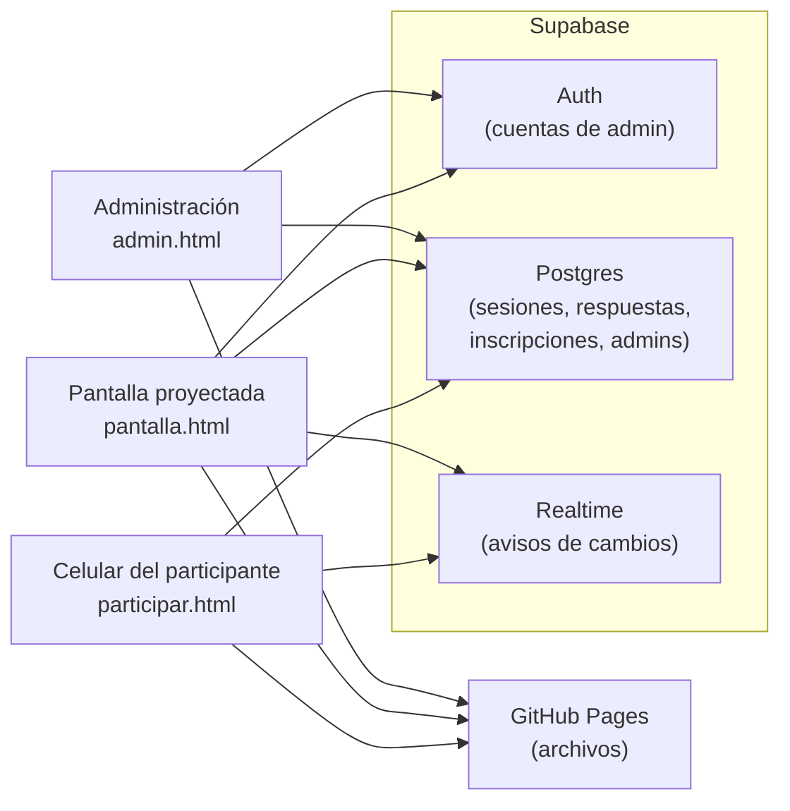
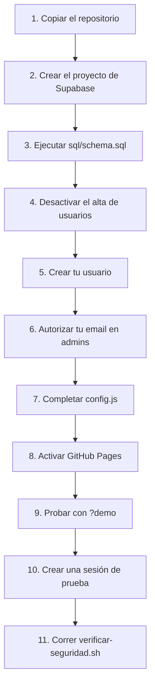

# Instalación

Esta guía da de alta una instancia propia: tu copia del repositorio en GitHub Pages y tu proyecto de Supabase.

## Cómo funciona

Las tres páginas son archivos estáticos. El navegador de cada persona los descarga de GitHub Pages y habla directo con Supabase.



## Pasos



### 1. Copiar el repositorio

1. Abrí el repositorio en GitHub.
2. Tocá **Use this template** → **Create a new repository**. Si ese botón no aparece, tocá **Fork**.
3. Elegí tu cuenta como dueña y un nombre para el repositorio. Dejalo **Public**.
4. Tocá **Create repository** (o **Create fork**).

Deberías ver tu copia en `https://github.com/TU-USUARIO/TU-REPO`, con los archivos `participar.html`, `pantalla.html`, `admin.html` y `config.js`.

### 2. Crear el proyecto de Supabase

1. Entrá a [supabase.com](https://supabase.com) y tocá **New project**.
2. Elegí la organización, un nombre, una contraseña para la base y la región más cercana al público.
3. Tocá **Create new project** y esperá a que termine de crearse.

Deberías ver el panel del proyecto, sin el aviso de que se está creando.

### 3. Ejecutar `sql/schema.sql`

1. En tu copia del repositorio, abrí `sql/schema.sql` y copiá todo su contenido.
2. En Supabase, abrí **SQL Editor** y tocá **New query**.
3. Pegá el contenido y tocá **Run**.

Deberías ver `Success. No rows returned`. En **Table Editor** deberías ver las tablas `admins`, `sesiones`, `respuestas` e `inscripciones`.

El archivo se puede ejecutar más de una vez. Hacelo de nuevo cada vez que actualices tu copia del repositorio.

### 4. Desactivar el alta de usuarios

Este paso va antes que los dos siguientes. Cualquier cuenta con un email de la tabla `admins` administra todas las sesiones: si el alta está abierta, otra persona podría registrarse con ese email antes que vos.

1. Abrí **Authentication** → **Sign In / Providers**.
2. Desactivá **Allow new users to sign up**.
3. Tocá **Save changes**.

Deberías ver el interruptor **Allow new users to sign up** apagado al recargar la página.

### 5. Crear tu usuario

1. Abrí **Authentication** → **Users**.
2. Tocá **Add user** → **Create new user**.
3. Escribí tu email y una contraseña.
4. Marcá **Auto Confirm User**.
5. Tocá **Create user**.

Deberías ver tu email en la lista de usuarios, sin el estado "Waiting for verification".

### 6. Autorizar tu email en `admins`

1. Abrí **SQL Editor** → **New query**.
2. Ejecutá esta línea con el mismo email del paso 5:

   ```sql
   insert into admins values ('tu@email');
   ```

Deberías ver `Success. No rows returned`. En **Table Editor** → `admins` deberías ver tu email.

Las siguientes personas que administren se autorizan desde `admin.html`, en **Personas que pueden administrar**. Su usuario se crea igual que en el paso 5.

### 7. Completar `config.js`

`config.js` trae la URL y la key de otra instalación. Reemplazá los dos valores por los de tu proyecto.

1. En Supabase, abrí **Project Settings** → **Data API** y copiá la **Project URL**.
2. Abrí **Project Settings** → **API Keys** y copiá la **Publishable key** (empieza con `sb_publishable_`). No uses la **Secret key**.
3. En GitHub, abrí `config.js` en tu copia y tocá el lápiz (**Edit this file**).
4. Pegá los valores:

   ```js
   export const CONFIG = {
     supabaseUrl: 'https://TU-PROYECTO.supabase.co',
     supabaseKey: 'sb_publishable_…',
     preset: 'neutro',
   };
   ```

5. Tocá **Commit changes**.

Deberías ver tus valores en `config.js` en la rama `main`.

La publishable key es pública: la lee cualquier persona que abra la página. Lo que protege los datos son las reglas de `sql/schema.sql`.

`preset` es la estética que usan las sesiones nuevas. Ver [Estética](estetica.md).

### 8. Activar GitHub Pages

1. En tu copia del repositorio, abrí **Settings** → **Pages**.
2. En **Source** elegí **Deploy from a branch**.
3. En **Branch** elegí `main` y la carpeta `/ (root)`.
4. Tocá **Save**.
5. Abrí la pestaña **Actions** y esperá a que termine **pages build and deployment**.

Deberías ver, en **Settings** → **Pages**, el aviso "Your site is live at `https://TU-USUARIO.github.io/TU-REPO/`".

En el resto de esta guía, `SITIO` es esa dirección.

### 9. Probar con `?demo`

El modo demo usa una sesión de ejemplo guardada en el navegador. No toca Supabase.

1. Abrí `SITIO/pantalla.html?demo` en una pestaña.
2. Abrí `SITIO/participar.html?demo` en otra pestaña del mismo navegador.
3. En la pantalla, tocá **Siguiente →**.
4. En la pestaña del participante, completá el registro.
5. En la pantalla, tocá **Siguiente →** otra vez y respondé una pregunta en la pestaña del participante.

Deberías ver la pestaña del participante avanzar sola con cada paso, y la respuesta contada en la pantalla.

### 10. Crear una sesión de prueba

1. Abrí `SITIO/admin.html`.
2. Entrá con el email y la contraseña del paso 5.

   Deberías ver **Crear una sesión** y la lista **Sesiones**, vacía.

3. En **Título** escribí `Prueba`. En **Código** escribí `prueba`. Tocá **Crear y editar**.
4. En la sección **Copiar entre instalaciones**, usá el selector de archivo que está debajo de **Pegar JSON** y elegí `demo/sesion-ejemplo.json` de tu copia del repositorio. También podés pegar su contenido en **Pegar JSON**.
5. Tocá **Reemplazar con este JSON** y confirmá.
6. Tocá **Guardar**.

   Deberías ver "Guardado." junto al botón.

7. Tocá **← Volver a la lista**. En la sesión `prueba`, tocá **Abrir pantalla**.
8. En el celular, escaneá el QR de la pantalla.

Deberías ver la sesión en el celular y, en la pantalla, los botones **← Anterior** y **Siguiente →** al mover el mouse.

### 11. Correr `herramientas/verificar-seguridad.sh`

El script prueba con la publishable key lo que una persona sin cuenta no debería poder hacer. No deja datos guardados.

Necesita `bash`, `curl`, `jq` y `uuidgen`, y una sesión activa con una opción que pida texto obligatorio. La sesión `prueba` del paso 10 cumple eso.

1. En una terminal, dentro de una copia local del repositorio, ejecutá:

   ```sh
   bash herramientas/verificar-seguridad.sh https://TU-PROYECTO.supabase.co sb_publishable_… prueba
   ```

Deberías ver ocho líneas que empiezan con `OK` y ninguna con `FALLA`.

Si aparece `FALLA`, volvé a ejecutar `sql/schema.sql` (paso 3) y repetí el script.

## Probar en tu computadora

Las páginas son módulos de JavaScript: no funcionan abriendo el archivo con doble clic. Servilas desde la carpeta del repositorio:

```sh
python3 -m http.server 8000
```

Abrí `http://localhost:8000/participar.html?demo`. Deberías ver la sesión de ejemplo.

Usá `localhost`, no la IP de la red: `participar.html` y `pantalla.html` necesitan HTTPS o `localhost`. Ver [Problemas conocidos](problemas.md).
