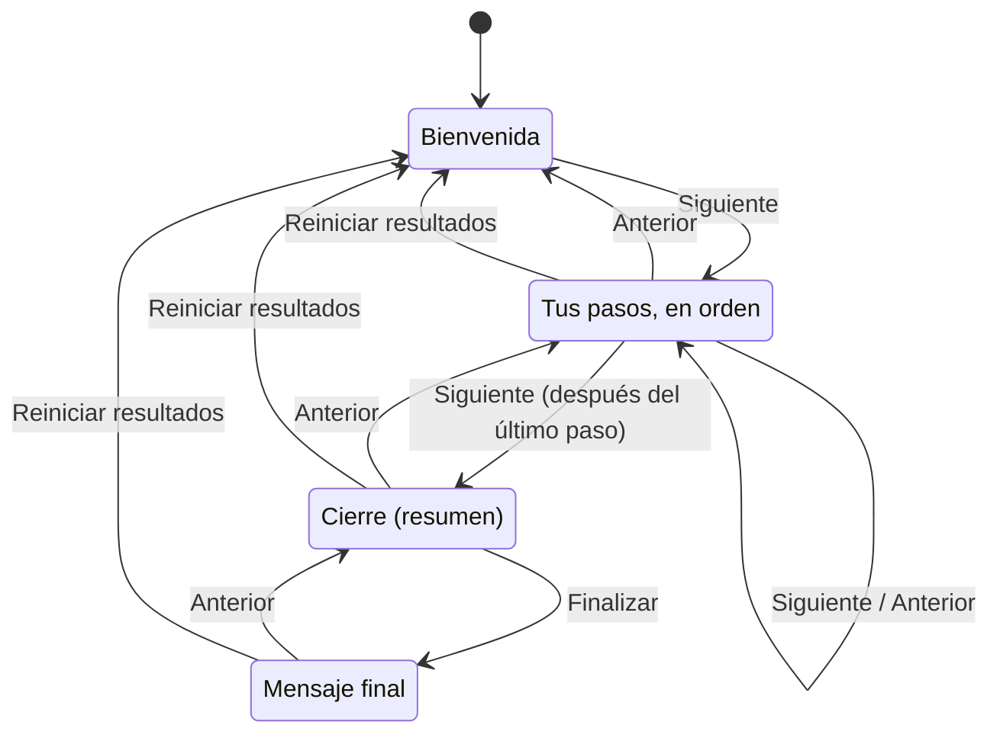

# Sesiones

Una sesión es un conjunto de pasos que se presentan en orden. Se crea y se edita en `admin.html`, se proyecta con `pantalla.html` y cada participante la sigue en `participar.html`.

## Ciclo de una sesión

Toda sesión empieza en **Bienvenida**, recorre tus pasos, pasa por **Cierre** y termina en el **mensaje final**. Quien presenta avanza y retrocede con la pantalla.



## Qué ve cada pantalla en cada paso

| Paso | Celular (`participar.html`) | Pantalla (`pantalla.html`) |
|---|---|---|
| Bienvenida | Título, instrucciones y aviso de espera. Si el primer paso es un registro obligatorio, el formulario de registro. | Título, QR, dirección corta, código y cantidad de personas conectadas. |
| Registro | El formulario. Después de enviarlo, "Recibimos tu registro". | Cantidad de personas registradas. |
| Lista de preguntas | La lista, con "N de M respondidas". Cada pregunta respondida queda marcada "✓ Respondida". | Una tarjeta por pregunta con la opción más elegida, su porcentaje y el total. Tocá una tarjeta para ver el detalle. |
| Pregunta guiada | La pregunta con sus opciones. Después de enviar, "Ya registramos tu respuesta". | Una barra por opción con cantidad y porcentaje sobre el total, y los últimos ocho textos. |
| Cierre | "¡Gracias! Mirá la pantalla." | El resumen de todas las preguntas, con el mismo detalle al tocar una tarjeta. |
| Mensaje final | El título y el texto del mensaje final. | El título y el texto del mensaje final. |

## Crear una sesión

1. Abrí `admin.html` y entrá con tu email y contraseña.
2. En **Crear una sesión**, escribí el **Título** y el **Código**.
3. Tocá **Crear y editar**.

Deberías ver el editor con el título "Editar: CODIGO" y un paso **Lista de preguntas** vacío.

El código va en el link de participantes. Tiene entre 3 y 30 letras minúsculas, números o guiones. Las mayúsculas, tildes y espacios se convierten solos: " Mi Sesión " queda `mi-sesion`. Debajo del campo se ve el link que va a resultar.

Una sesión nueva no se puede guardar hasta que su lista tenga al menos una pregunta.

## Editar una sesión

1. En la lista **Sesiones**, tocá **Editar**.
2. Cambiá lo que necesites.
3. Tocá **Guardar**.

Deberías ver "Guardado." junto al botón. Si algo está mal, deberías ver arriba la lista "No se guardó. Corregí esto:" con cada problema.

Si la sesión está en curso, los celulares y la pantalla reciben el cambio al instante. Un celular con un comentario o un registro a medio escribir aplica el cambio después de enviar o volver.

**Datos generales**: el título de la sesión, las instrucciones de la Bienvenida y el título y el texto del mensaje final.

**Estética**: ver [Estética](estetica.md).

**Pasos**: se muestran en el orden del editor, entre la Bienvenida y el Cierre. Usá **↑** y **↓** para moverlos y **Quitar** para borrarlos.

## Tipos de paso

| Tipo | Qué hace |
|---|---|
| **Lista de preguntas** | Muestra todas sus preguntas juntas. Cada persona elige cuál responder y vuelve a la lista. Las opciones son las mismas para todas las preguntas de la lista. |
| **Pregunta guiada** | Una sola pregunta, con sus propias opciones. Todos la ven a la vez. |
| **Registro** | Un formulario de datos personales. |

Cada pregunta tiene:

- **Texto**: la pregunta.
- **Descripción** (opcional): se muestra debajo. En el celular, si es larga, aparece **Ver más**.
- **Etiquetas** (opcional): una por línea. Se muestran como rótulos debajo de la pregunta.

Cada registro tiene:

- **Título** y **Descripción** (opcional).
- **Obligatorio**: nadie responde sin registrarse. Un registro obligatorio tiene que ser el primer paso; las personas lo completan durante la Bienvenida.
- **Campos**: cada uno con nombre, tipo y la casilla **Obligatorio**. Los tipos son **Texto corto**, **Texto largo**, **Email**, **Teléfono**, **Número** y **Desplegable (elegir de una lista)**. Un desplegable necesita al menos dos opciones, una por línea.

Los datos del registro solo los leen las cuentas de administración. La pantalla muestra únicamente el total.

## Opciones y "pide texto"

Una pregunta tiene **ninguna opción** o **entre 2 y 6**.

- **Ninguna opción**: la persona responde con texto libre.
- **Entre 2 y 6**: la persona elige una.

Cada opción tiene un **¿Pide texto?**:

| Valor | Efecto en el celular |
|---|---|
| **No pide texto** | Se elige y se envía. |
| **Pide texto (opcional)** | Al elegirla aparece un campo **Comentario** que se puede dejar vacío. |
| **Pide texto (obligatorio)** | Al elegirla aparece el campo **Comentario** y no se puede enviar vacío. |

Usá "pide texto" para opciones como "Comentar" u "Otro". Los textos tienen hasta 1000 caracteres.

## Pegar varias preguntas de una vez

En un paso **Lista de preguntas**, abrí **Pegar varias preguntas de una vez**.

Sin ninguna línea que empiece con `## `, cada línea es una pregunta:

```text
Primera pregunta
Segunda pregunta
Tercera pregunta
```

Con `## `, cada `## ` empieza una pregunta. Las líneas que siguen son su descripción y las que empiezan con `- ` (o `* `) son sus etiquetas:

```text
## Salud
Datos de hospitales y vacunación.
- Hospitales
- Vacunas

## Transporte
Horarios y recorridos.
- Colectivos
```

Las líneas vacías se ignoran. Con `## `, el texto que está antes del primer `## ` también se ignora. Varias líneas de descripción se unen en una sola.

1. Pegá el texto en **Texto a pegar**.
2. Tocá **Agregar estas preguntas**.
3. Revisalas y tocá **Guardar**.

Deberías ver "Se agregaron N preguntas. Revisalas y tocá Guardar." Las preguntas se suman al final de la lista.

## Presentar

1. En la lista **Sesiones**, tocá **Abrir pantalla**. Se abre `pantalla.html?s=CODIGO` en otra pestaña.
2. Proyectá esa pestaña en pantalla completa (F11 en la mayoría de los navegadores).
3. Compartí el link con **Copiar link de participantes** o mostrá el QR con **Ver QR**. La Bienvenida también muestra el QR y el código.

Deberías ver la Bienvenida con el QR y, al mover el mouse, la barra **← Anterior** / **Siguiente →**. La barra se oculta sola a los tres segundos.

La pantalla solo se maneja desde un navegador con una cuenta de administración iniciada en `admin.html`. Sin esa cuenta, `pantalla.html?s=CODIGO` muestra la sesión sin controles: podés proyectar esa versión y manejar el paso desde otro dispositivo con la cuenta iniciada.

| Tecla | Acción |
|---|---|
| → · AvPág · barra espaciadora | Paso siguiente |
| ← · RePág | Paso anterior |
| Escape | Cerrar el detalle de una pregunta |

Estas teclas son las que envía un control remoto de presentaciones.

En el último paso antes del mensaje final, el botón dice **Finalizar**. En el mensaje final no hay botón de avance.

En una **Lista de preguntas** y en el **Cierre**, tocá una tarjeta para ver el detalle de esa pregunta. Tocá **← Volver al resumen** o apretá Escape para volver. El detalle solo cambia esta pantalla, no los celulares.

## Exportar

**Respuestas**: en la lista **Sesiones**, tocá **Exportar CSV**. Se descarga `CODIGO-respuestas.csv`.

Deberías ver "Descargado: N respuestas."

El archivo tiene una fila por respuesta, con estas columnas: `fecha`, `participante`, una columna por cada campo de registro, `pregunta`, `opcion` y `texto`. Las personas que se registraron sin responder nada aparecen en una fila con `pregunta`, `opcion` y `texto` vacíos. El archivo está en UTF-8 y se abre con Excel o con una planilla de cálculo.

**Configuración**: en el editor, sección **Copiar entre instalaciones**, tocá **Descargar JSON**. Ese archivo se carga en otra sesión o en otra instalación con **Pegar JSON** → **Reemplazar con este JSON** → **Guardar**.

## Reiniciar

**Reiniciar resultados** borra todas las respuestas y registros de la sesión y la vuelve a la Bienvenida. No se puede deshacer.

1. Exportá el CSV si querés conservar los resultados.
2. En la lista **Sesiones**, tocá **Reiniciar resultados**.
3. Escribí el código de la sesión y tocá **Borrar resultados**.

Deberías ver "Se borraron los resultados de "CODIGO"." Los celulares vuelven a la Bienvenida y olvidan qué preguntas habían respondido y si se habían registrado.

## Otras acciones

- **Duplicar**: crea una sesión nueva con la misma configuración y sin respuestas. Pide el código de la copia.
- **Archivar**: nadie puede entrar a la sesión. Un celular abierto vuelve a pedir el código y una pantalla abierta muestra "Esta sesión ya no está disponible". **Desarchivar** la vuelve a habilitar.

## Qué no se puede editar cuando hay respuestas

Cada respuesta se guarda atada al id de su pregunta y de su opción, no al texto. Por eso podés corregir textos en cualquier momento. Lo que cambiaría el sentido de respuestas ya guardadas está bloqueado:

| No se puede | Cuándo |
|---|---|
| Borrar una pregunta | Si tiene respuestas. |
| Pasar una pregunta entre texto libre y opciones | Si tiene respuestas. |
| Borrar una opción | Si alguien la eligió. |
| Cambiar el **¿Pide texto?** de una opción | Si alguien la eligió. |

Al tocar **Guardar** deberías ver cuál de estos cambios bloqueó el guardado. Para hacerlo igual, exportá el CSV y usá **Reiniciar resultados**, o creá otra sesión con **Duplicar**.
